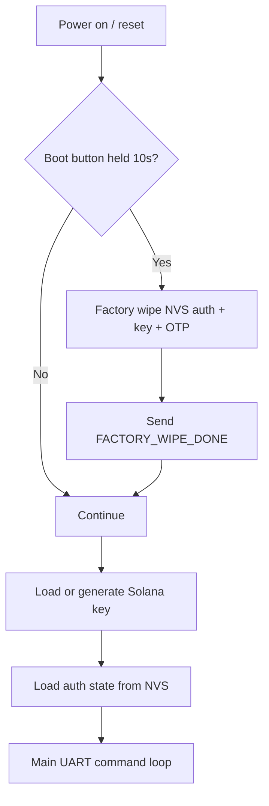
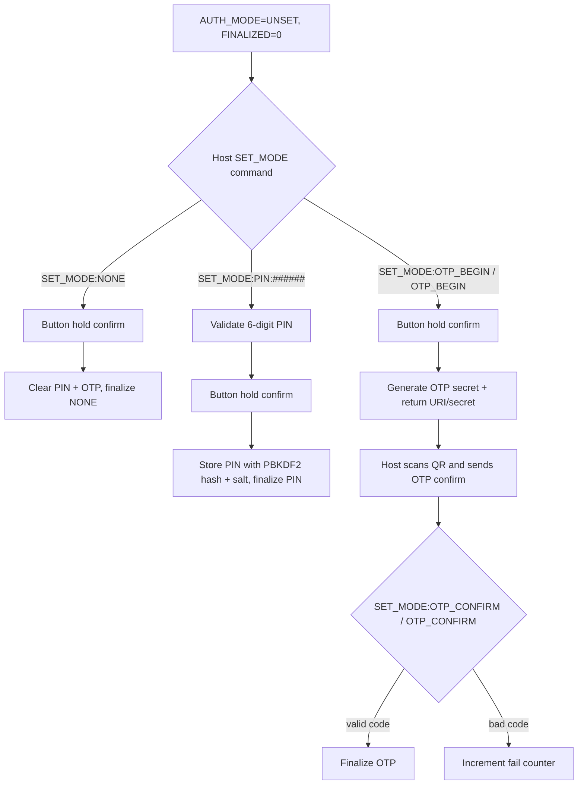
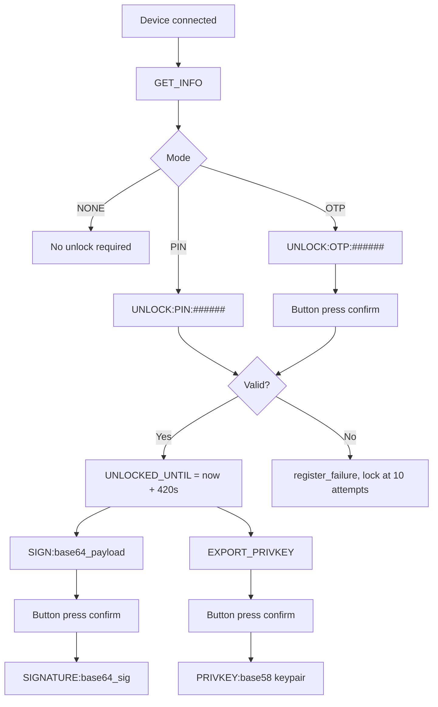
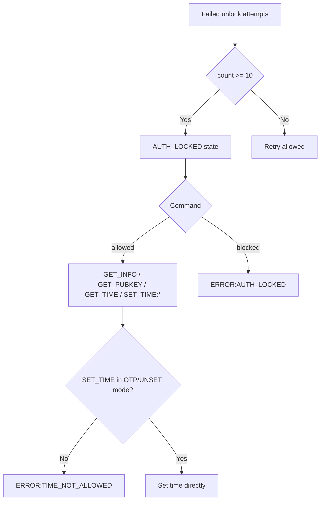

# ESP32 Signer Firmware Flow

## 1) Boot and Initialization

## 2) First-Time Setup (Auth Mode)

## 3) Session Unlock + Signing

## 4) Lock, Recovery, and Time Sync

## 5) Security Properties (Current)

- Signing always requires physical button press.
- PIN mode uses salted PBKDF2-HMAC-SHA256 only.
- Auth lockout after 10 failures is persisted in NVS.
- `SET_TIME` is restricted to `UNSET`/`OTP` modes and is host-driven (no button gate).
- `UNLOCK:OTP` requires physical button press confirmation (8s timeout).
- Factory wipe clears Solana key, auth state, PIN material, and OTP secrets.

## 6) Migration Note

- This firmware uses one PIN format only (PBKDF2). Devices that were on older SHA256-only PIN firmware should be factory-wiped once before use.
